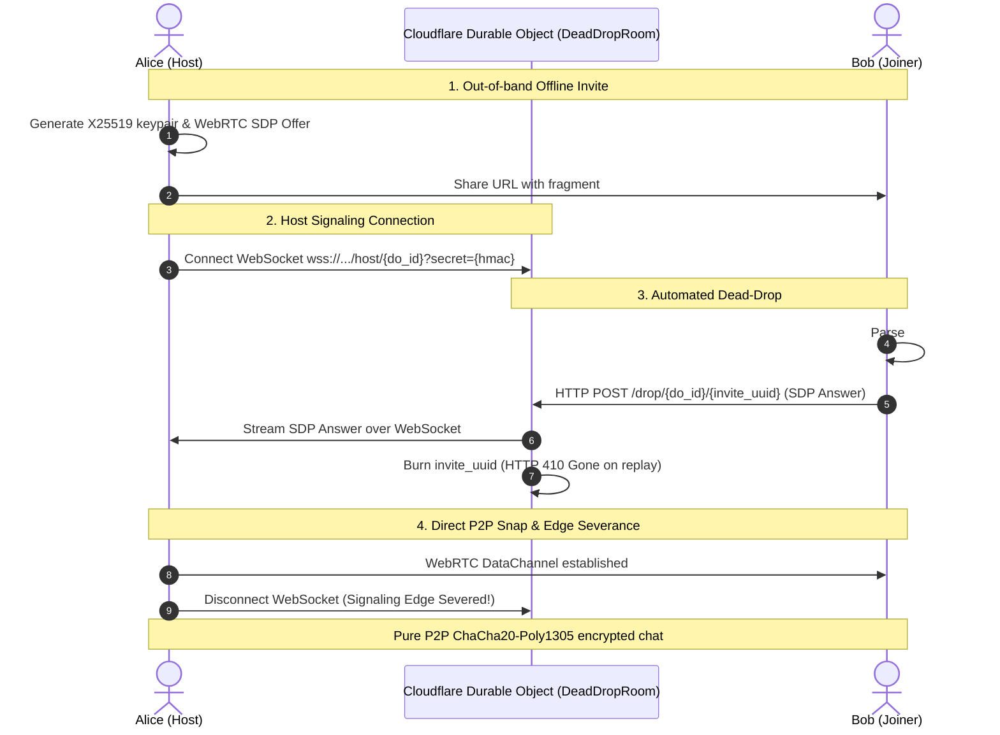

# ZeroChat

<p align="center">
  <strong>Serverless, Ephemeral P2P Chat with Zero Data Persistence</strong>
</p>

<p align="center">
  
  
  
  
  
  
</p>

---

## ⚡ Overview

**ZeroChat** is a peer-to-peer web chat application engineered from the ground up for **absolute privacy and zero data persistence**. It eliminates centralized chat servers, cloud message databases, and client-side storage caches.

Communication occurs directly between browsers over **WebRTC DataChannels** encrypted using **ChaCha20-Poly1305** symmetric AEAD, with ephemeral keys established via **X25519 Diffie-Hellman** key exchange. Cloudflare Workers and hibernating Durable Objects (`DeadDropRoom`) facilitate initial handshake signaling, after which the signaling edge connection is **immediately severed**.

Closing your browser tab destroys the ephemeral in-memory state permanently. **Zero trace is left behind.**

---

## 🔒 Security & Privacy Guarantees

- **Zero Client-Side Persistence**: Automated test audits verify that `localStorage`, `sessionStorage`, `indexedDB`, and cache storage remain completely empty throughout the entire application lifecycle.
- **Immediate Edge Severance**: The host signaling WebSocket connection is intentionally terminated the exact millisecond the direct WebRTC DataChannel transitions to `Open`.
- **Authenticated Encryption**: Every chat packet is sealed with ChaCha20-Poly1305 using an authenticated 12-byte random nonce and 16-byte Poly1305 MAC tag. Tampered or modified packets are rejected instantly.
- **Ephemeral Signaling**: WebRTC SDP offers and answers are exchanged via single-use, HMAC-SHA256 authenticated dead-drop mailboxes in Cloudflare Durable Objects. Burned mailbox UUIDs return HTTP 410 Gone and are automatically purged from edge memory.
- **Anti-Entropy Mesh Routing**: Supports multi-peer rooms using decentralized broadcast flooding, automatic duplicate loop suppression, and peer disconnect cleanup without cloud relaying.

---

## 📐 Architecture & Signaling Sequence



---

## 📦 Project Structure

```text
zero_chat/
├── .github/workflows/
│   ├── ci.yml               # Multi-crate lint, format, and test verification
│   └── deploy.yml           # Automated deployment to Cloudflare Workers & Pages
├── crates/
│   ├── zero_protocol/       # Wire protocol envelopes, ChaCha20-Poly1305 AEAD, HMAC-SHA256
│   ├── zero_network/        # Cloudflare Worker & DeadDropRoom SQLite Durable Object
│   └── zero_client/         # WebAssembly WebRTC engine, mesh routing & glassmorphic UI
├── docs/
│   └── deployment.md        # Cloudflare credentials and CI/CD secret configuration
├── openspec/                # Software design specifications and roadmap manifests
├── scripts/
│   └── deploy_dry_run.sh    # Pre-flight build and artifact validation script
└── Cargo.toml               # Cargo workspace manifest
```

---

## 🚀 Getting Started

### Prerequisites

- [Rust](https://rustup.rs/) (stable toolchain)
- `wasm32-unknown-unknown` compilation target:
  ```bash
  rustup target add wasm32-unknown-unknown
  ```
- Optional local tools: `wasm-bindgen-cli`, `worker-build`, `wrangler`.

### Running Tests

Execute the full workspace test suite (91 native and target integration tests):

```bash
cargo test --workspace
```

Verify clean code formatting and linting:

```bash
cargo fmt --all -- --check
cargo clippy --workspace --all-targets -- -D warnings
```

Compile the WebAssembly client:

```bash
cargo build -p zero_client --release --target wasm32-unknown-unknown
```

### Local Dry-Run Verification

Validate client packaging and Worker build configurations locally:

```bash
./scripts/deploy_dry_run.sh
```

---

## 🌐 Deployment to Cloudflare

Deployments are fully automated via GitHub Actions on push to `main`:

1. **Signaling Worker (`zero_network`)**:
   Deploys to **Cloudflare Workers** with the `DeadDropRoom` SQLite Durable Object binding.
2. **Web Client (`zero_client`)**:
   Compiles Rust to WebAssembly and deploys the static assets (`index.html`, `style.css`, `.wasm`, `.js`) to **Cloudflare Pages** (`zero-chat.pages.dev`).

For instructions on configuring GitHub repository secrets (`CLOUDFLARE_API_TOKEN`, `CLOUDFLARE_ACCOUNT_ID`), see [docs/deployment.md](docs/deployment.md).

---

## 📜 License

Licensed under either of:

- Apache License, Version 2.0 ([LICENSE-APACHE](LICENSE-APACHE) or http://www.apache.org/licenses/LICENSE-2.0)
- MIT license ([LICENSE-MIT](LICENSE-MIT) or http://opensource.org/licenses/MIT)

at your option.
