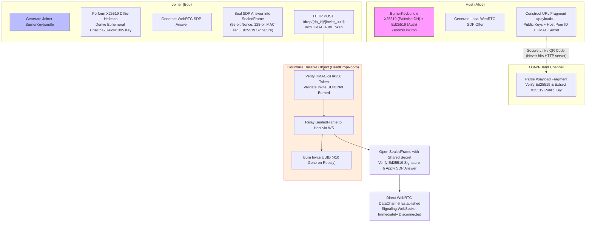

# ZeroChat (v1.0)

<p align="center">
  <strong>Ephemeral, Zero-Knowledge Peer-to-Peer Mesh Chat in Rust & WebAssembly</strong>
</p>

<p align="center">
  
  
  
  
  
  
  
  
</p>

---

## ⚡ Executive Summary & Privacy Invariants

**ZeroChat** is a production-grade, zero-knowledge, peer-to-peer mesh messaging engine engineered in pure Rust, WebAssembly, and Cloudflare serverless edge infrastructure. It is designed for maximum operational privacy, eliminating cloud databases, centralized chat relays, and forensic data trails.

### Core Privacy Invariants
1. **Zero Forensic Footprint**:
   - `0 localStorage`, `0 sessionStorage`, `0 cookies`, `0 indexedDB`, `0 persistent caches`.
   - Automated client audits continuously verify that browser storage APIs remain empty across the application lifecycle.
2. **Volatile Memory Scrubbing**:
   - Ephemeral keys, symmetric ratchets, plaintext buffers, and decrypted chat history are isolated exclusively to in-memory WebAssembly heap space.
   - On tab unload, session termination, or remote burn events, `WasmCryptoSession::burn_all()` deterministically zeroes out cryptographic structures implementing Rust's `Zeroize` and `ZeroizeOnDrop` traits.
3. **100% Blind Signaling Edge**:
   - Cloudflare Worker and hibernating SQLite Durable Objects (`DeadDropRoom`) act strictly as an encrypted single-use mailbox.
   - The edge never has access to unencrypted WebRTC session descriptions (SDP), ICE candidates, peer identities, or message payloads.
   - Signaling channels are destroyed the exact millisecond direct WebRTC DataChannels transition to `Open`.

---

## 📐 System Architecture Overview (3-Crate Monorepo)

ZeroChat is architected as a clean 3-crate workspace separating pure protocol primitives, serverless edge signaling, and the client WebAssembly/WebRTC runtime:

```text
                               ┌─────────────────────────────────────────────────────────┐
                               │                    Cloudflare Edge                      │
                               │                                                         │
                               │   zero_network (Worker + SQLite Durable Object)         │
                               │   - Single-use HMAC dead-drop router (/drop, /ws)       │
                               │   - 3-tier Cloudflare Realtime TURN provisioning (/ice) │
                               └────────────────────▲───────────────▲────────────────────┘
                                                    │               │
                            1. Ephemeral Dead-Drop  │               │ 2. Blind Answer Drop
                            Handshake (WSS / HTTP)  │               │    (HTTP POST)
                                                    │               │
                      ┌─────────────────────────────┴─┐           ┌─┴─────────────────────────────┐
                      │        Alice (Host)           │           │        Bob (Joiner)           │
                      │                               │           │                               │
                      │  zero_client (WASM Runtime)   │           │  zero_client (WASM Runtime)   │
                      │  - WasmCryptoSession          │           │  - WasmCryptoSession          │
                      │  - WebRTC DataChannels        │           │  - WebRTC DataChannels        │
                      │  - MeshTopologyManager        │           │  - MeshTopologyManager        │
                      └───────────────▲───────────────┘           └───────────────▲───────────────┘
                                      │                                           │
                                      │       3. Direct P2P WebRTC DataChannel    │
                                      └───────────────────────────────────────────┘
                                         ChaCha20-Poly1305 AEAD + Ed25519 Frames
                                         Mesh Relay Flooding (Zero Cloud Relay)
                                                          │
                                                          ▼
                                      ┌───────────────────────────────────────────┐
                                      │        crates/zero_protocol               │
                                      │  - Wire Envelopes (Invite/Drop/Relay)     │
                                      │  - X25519 ECDH Key Exchange               │
                                      │  - ChaCha20-Poly1305 AEAD Encryption      │
                                      │  - Ed25519 Envelope/Frame Signatures      │
                                      │  - HMAC-SHA256 Single-Use Tokens          │
                                      └───────────────────────────────────────────┘
```

### Monorepo Crates
- [`crates/zero_protocol`](crates/zero_protocol): Pure Rust cryptographic primitives, wire envelope serialization (`InvitePayload`, `DropPayload`, `SealedFrame`, `MeshRelaySignal`), ChaCha20-Poly1305 AEAD, X25519 Diffie-Hellman, Ed25519 digital signatures, and HMAC-SHA256 authentication tokens. Zero network or DOM dependencies.
- [`zero_network`](zero_network): Cloudflare Worker and hibernating SQLite Durable Object (`DeadDropRoom`) router. Implements single-use dead-drop dispatch (`/register`, `/drop`, `/ws`), replay protection, and 3-tier Cloudflare Realtime TURN token provisioning (`/ice`).
- [`zero_client`](zero_client): High-performance client compiling to `wasm32-unknown-unknown` via `wasm-bindgen`. Integrates `WasmCryptoSession`, decentralized mesh routing (`MeshTopologyManager`), WebRTC DataChannel lifecycle state machines, mobile visualViewport adjustment, and responsive glassmorphic UI.

---

## 🔐 Cryptographic Design (Modernized Burner Keybundle)

ZeroChat implements a zero-trust cryptographic model ensuring end-to-end forward secrecy, peer authenticity, and forward zero-trace guarantees:



1. **In-Memory `BurnerKeybundle`**:
   - Each peer generates a dual-keypair cryptographic identity on load: `X25519Keypair` for pairwise key agreement and `Ed25519Keypair` for envelope and frame signing.
   - All secret key buffers are guarded by `Zeroize` and `ZeroizeOnDrop`, ensuring instantaneous entropy wiping upon deallocation.
2. **Out-of-Band `#payload=` Fragment**:
   - The host's public keys, room identifier, and HMAC secret travel exclusively in the browser URL `#fragment`.
   - By RFC 3986 design, URL fragments are never transmitted to web servers or intermediate edge proxies during HTTP requests.
3. **100% Blind Dead-Drop (`sealed_sdp_answer`)**:
   - When a joiner responds to an invite, the joiner computes the shared X25519 secret and encrypts the WebRTC SDP answer into a `SealedFrame` before issuing the HTTP POST.
   - The Cloudflare Durable Object receives only ciphertext; the edge is 100% blind to WebRTC parameters, codec negotiations, and internal IP addresses.
4. **Per-Peer ChaCha20-Poly1305 AEAD & Digital Signatures**:
   - All mesh broadcast frames and direct chat payloads are sealed using ChaCha20-Poly1305 with a CSPRNG 96-bit nonce, 128-bit MAC authentication tag, and a 64-byte Ed25519 digital signature.
   - Frames failing MAC verification or digital signature checks are rejected instantly before reaching the UI feed.
5. **Deterministic Burn & Memory Zeroization**:
   - When a user explicitly leaves a room, a signed `PeerLeftAndBurn` signal is broadcast across the mesh.
   - Recipients immediately purge the departing peer's public keys and message history from memory.
   - Local tab closure triggers `cryptoSession.burn_all()`, overwriting active keys, secrets, and session state with zeros.

---

## 📶 Network & Mobile Resilience Engineering

Peer-to-peer WebRTC applications often struggle on mobile networks and symmetric NAT topologies. ZeroChat incorporates specific engineering optimizations to guarantee link establishment:

- **Adaptive Non-Trickle ICE Gathering**:
  - Employs an adaptive candidate settle timer: immediate completion when local host candidates are discovered on broadband networks, combined with a 350ms settle window when TURN relay candidates are encountered. This avoids excessive connection delays while gathering complete candidate bundles.
- **Mobile Background Freeze Grace Period (12s)**:
  - Mobile operating systems (iOS Safari, Android Chrome) aggressively suspend JavaScript execution when tabs enter the background or screens lock.
  - ZeroChat implements a 12-second grace period that distinguishes temporary mobile OS background sleep from intentional peer departures, preventing spurious disconnect re-keying.
- **3-Tier Cloudflare Realtime TURN Traversal (`/ice`)**:
  - Dynamically provisions ephemeral credentials for Cloudflare Realtime TURN over STUN, TURN (UDP), and TURN (TLS over port 443).
  - Traverses carrier-grade NATs (CGNAT), restrictive 4G/5G mobile firewalls, and enables same-device cellular multi-tab hairpinning.

---

## 🛠️ Local Development, Testing & Verification Guide

### Prerequisites
- [Rust](https://rustup.rs/) (stable toolchain)
- Target `wasm32-unknown-unknown`:
  ```bash
  rustup target add wasm32-unknown-unknown
  ```
- Node.js (v18+) & Python 3 (for headless browser E2E test harness)

### Workspace Verification Commands

1. **Rust Workspace Unit & Integration Tests (117+ Tests)**:
   ```bash
   cargo test --workspace
   ```
2. **Strict Linter Checks**:
   ```bash
   cargo clippy --workspace --all-targets -- -D warnings
   ```
3. **Code Formatting Check**:
   ```bash
   cargo fmt --all -- --check
   ```
4. **Build & Validate Optimized WebAssembly Bundle**:
   ```bash
   ./scripts/deploy_dry_run.sh
   ```
5. **Headless Browser E2E Mesh Tests (23 Scenarios)**:
   ```bash
   bash zero_client/tests/browser/run_test.sh
   ```

---

## 🌐 Cloudflare Workers & Pages Deployment

Deployments are automated through GitHub Actions upon push to `main` (see `.github/workflows/deploy.yml`):

### 1. Signaling Worker (`zero_network`)
Deploys to **Cloudflare Workers** with the hibernating SQLite Durable Object binding (`DeadDropRoom`):
```bash
cd zero_network
npx wrangler deploy
```

### 2. Client Web Application (`zero_client`)
Compiles to WebAssembly and static web assets (`index.html`, `style.css`, `.wasm`, `.js`) deployed to **Cloudflare Pages**:
```bash
# Build release WASM binary
cargo build -p zero_client --release --target wasm32-unknown-unknown

# Deploy static bundle to Pages
npx wrangler pages deploy zero_client/pkg --project-name zero-chat
```

For detailed instructions on configuring GitHub repository secrets (`CLOUDFLARE_API_TOKEN`, `CLOUDFLARE_ACCOUNT_ID`), refer to [docs/deployment.md](docs/deployment.md).

---

## 📜 License

ZeroChat is dual-licensed under:

- Apache License, Version 2.0 ([LICENSE-APACHE](LICENSE-APACHE) or http://www.apache.org/licenses/LICENSE-2.0)
- MIT license ([LICENSE-MIT](LICENSE-MIT) or http://opensource.org/licenses/MIT)

at your option.
