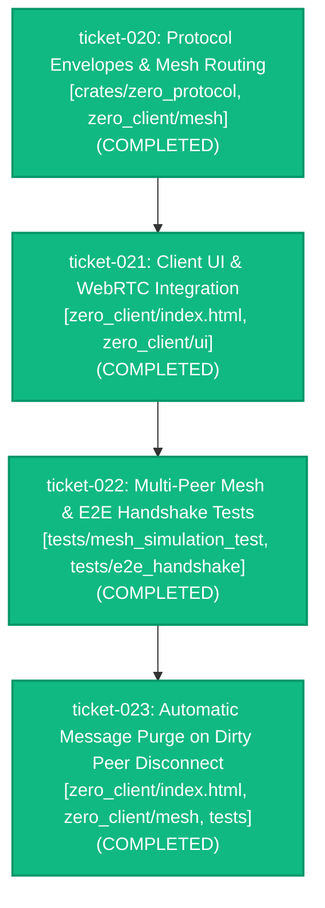

# Milestone Roadmap: Improved Leave and Burn Lifecycle

## 1. Milestone Objective & Scope

Currently, the Leave Chat button (`#header-leave-btn`) and Burn Chat button (`#destroy-session-button`) share identical behavior: both unilaterally execute local-only session resets (`resetToHome()`), tearing down local WebRTC peer connections and clearing local DOM without coordinating with or notifying remote peers. Furthermore, when a peer leaves, their previously sent messages linger indefinitely in the other participants' feeds.

This roadmap upgrades the Leave and Burn lifecycle into two distinct, cryptographically authenticated, mesh-coordinated operations:
1. **Leave Chat (`leave_and_burn`)**:
   - The leaving user wipes their local session and returns to the home view.
   - A `PeerLeftAndBurn` signal is broadcast across the P2P mesh before connection severance.
   - Upon receiving this signal, all remaining peer clients immediately purge from their local DOM and memory all messages authored by the departed peer (`data-peer-id`).
   - The remaining peers continue their conversation uninterrupted.
2. **Burn Chat (`global_burn`)**:
   - Any participant can trigger an irreversible global room burn.
   - A `GlobalBurnSession` signal is broadcast across all active DataChannels and flooded through the gossip mesh.
   - Every participant receiving this signal instantly wipes their feed, zeroizes in-memory cryptographic keys, tears down all peer connections, and transitions back to the home view simultaneously.
3. **Dirty Disconnect & Window Unload Purge**:
   - When a peer disconnects dirty (closes window, refreshes tab, or loses connection abruptly), peer clients automatically purge that departed user's messages and advance chat seamlessly.

---

## 2. Ticket Dependency Matrix

| Ticket ID | Title | Thinking Level | Depends On | Concurrency Track | State |
| :--- | :--- | :---: | :--- | :--- | :--- |
| `ticket-020` | Protocol Envelopes & Mesh Routing for Selective Message Purging and Global Burn | `MEDIUM` | `[]` | `PARALLEL_ELIGIBLE` | `COMPLETED` |
| `ticket-021` | Client UI & WebRTC Integration: Distinct Leave (Selective Purge) vs Burn (Global Annihilation) | `MEDIUM` | `["ticket-020"]` | `PARALLEL_ELIGIBLE` | `COMPLETED` |
| `ticket-022` | Multi-Peer Mesh Integration & E2E Handshake Validation for Leave and Burn Lifecycle | `MEDIUM` | `["ticket-021"]` | `PARALLEL_ELIGIBLE` | `COMPLETED` |
| `ticket-023` | Automatic Message Purge on Dirty Peer Disconnect & Window Unload | `MEDIUM` | `["ticket-022"]` | `PARALLEL_ELIGIBLE` | `COMPLETED` |

---

## 3. Blast Radius & Scope Collision Matrix

| Ticket ID | Declared File Scope | Overlap Detection & Blast Radius Rationale |
| :--- | :--- | :--- |
| `ticket-020` | `crates/zero_protocol/src/envelope.rs`, `zero_client/src/mesh.rs` | Protocol signaling extensions (`PeerLeftAndBurn`, `GlobalBurnSession`) and mesh broadcast/routing callback infrastructure. Disjoint from UI templates and tests. |
| `ticket-021` | `zero_client/index.html`, `zero_client/src/ui.rs`, `zero_client/style.css` | Client DOM integration, message sender tracking (`data-peer-id`), distinct button event handlers, and incoming signal dispatching. Dependent on `ticket-020` signal definitions. |
| `ticket-022` | `tests/mesh_simulation_test.rs`, `tests/e2e_handshake.rs` | Comprehensive integration tests validating selective message purge across 3+ peers and global burn room annihilation. Dependent on `ticket-021` client integration. |
| `ticket-023` | `zero_client/index.html`, `zero_client/src/mesh.rs`, `tests/mesh_simulation_test.rs` | Automatic message purge on channel closure/disconnect, opportunistic `beforeunload` broadcast, and multi-peer dirty disconnect integration tests. |

---

## 4. Execution DAG Diagram

---

## 5. Milestone Progress & Completion Criteria

- [x] **Track 1 (`ticket-020`)**: `MeshRelaySignal::PeerLeftAndBurn` and `MeshRelaySignal::GlobalBurnSession` signals specified, tested, and routed in `zero_protocol` and `zero_client::mesh`.
- [x] **Track 2 (`ticket-021`)**: Web client stamps messages with `data-peer-id`, connects `#header-leave-btn` to selective peer burn + local reset, connects `#destroy-session-button` to global session burn, and handles remote burn signals.
- [x] **Track 3 (`ticket-022`)**: Automated multi-peer tests confirm selective message burning upon peer departure and global room wipe upon burn invocation. Zero regressions across existing 91 workspace tests.
- [x] **Track 4 (`ticket-023`)**: Automatic message purge on dirty disconnect (abrupt channel close) & opportunistic window unload in client UI and mesh topology. Zero regressions across full workspace.
