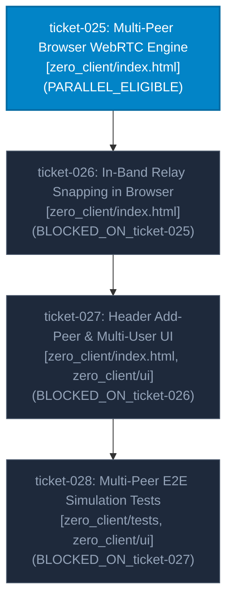

# Milestone Roadmap: Multi-User P2P Mesh Chat

## 1. Milestone Objective & Scope

While the Rust core (`zero_client::mesh`, `zero_protocol`) already implements multi-peer gossip routing, TTL flooding, and in-band relay signaling in simulation tests, the browser application (`zero_client/index.html`) is currently constrained to 1-to-1 chats via a single-peer `RTCPeerConnection`.

This milestone expands Zero-Chat into a full-featured, zero-knowledge, multi-participant decentralized mesh room:
1. **Multi-Peer WebRTC Engine**: Refactor the browser client from a single connection to a multi-peer connection pool supporting concurrent WebRTC DataChannels with broadcast flooding.
2. **In-Band Signaling Relay & Direct Mesh Snapping**: When a 3rd peer joins the host, the host uses in-band DataChannel relay messages (`RelaySdpOffer` / `RelaySdpAnswer`) to introduce the new peer to existing peers, enabling them to establish direct P2P connections without hitting Cloudflare servers.
3. **Header Add-Peer Button & Single-Invite Lifecycle**:
   - Place an Add-Peer (`+`) button directly to the **left** of the `#peer-count` badge in the header.
   - Enforce a strictly non-wasteful, single active invite lifecycle: only one pending invite is active at a time; subsequent clicks re-copy the existing link; pending invite clears when peer connects.
   - Strictly **no tooltip messages**; silent clipboard copy.
4. **Dynamic Multi-Peer UI & Lifecycle**:
   - Dynamic peer count badge (`0`, `1`, `2`, `3`...).
   - Per-peer color attribution and distinct sender display.
   - Graceful multi-peer departure: when 1 of N peers leaves, the room remains active for surviving peers and only drops to disconnected state when all peers depart.

---

## 2. Ticket Dependency Matrix

| Ticket ID | Title | Thinking Level | Depends On | Concurrency Track | State |
| :--- | :--- | :---: | :--- | :--- | :--- |
| `ticket-025` | Multi-Peer Browser WebRTC Engine & Connection Pool | `MEDIUM` | `[]` | `PARALLEL_ELIGIBLE` | `COMPLETED` |
| `ticket-026` | In-Band SDP Signaling Relay & Mesh Snapping in Browser Client | `HIGH` | `["ticket-025"]` | `PARALLEL_ELIGIBLE` | `IN_PROGRESS` |
| `ticket-027` | Header Add-Peer Button, Single-Invite Lifecycle & Multi-User Room UI | `MEDIUM` | `["ticket-026"]` | `BLOCKED_ON_ticket-026` | `PLANNING` |
| `ticket-028` | Multi-Peer E2E Simulation & Mesh Snapping Validation Suite | `MEDIUM` | `["ticket-027"]` | `BLOCKED_ON_ticket-027` | `PLANNING` |

---

## 3. Blast Radius & Scope Collision Matrix

| Ticket ID | Declared File Scope | Overlap Detection & Blast Radius Rationale |
| :--- | :--- | :--- |
| `ticket-025` | `zero_client/index.html` (WebRTC Engine core) | Refactors `ZeroWebRtcEngine` to manage `Map<peerId, { pc, dc }>` and broadcast sending. Pre-requisite for relay and UI layers. |
| `ticket-026` | `zero_client/index.html` (In-Band Relay module) | Implements in-band relay SDP offer/answer exchange across open DataChannels for direct mesh snapping. Builds on multi-peer engine from `ticket-025`. |
| `ticket-027` | `zero_client/index.html` (DOM header & invite controls), `zero_client/src/ui.rs` | Header Add-Peer button (left of `#peer-count`), single-invite lifecycle logic, dynamic peer counter, multi-peer departure tracking. |
| `ticket-028` | `zero_client/tests/mesh_simulation_test.rs`, `zero_client/src/ui.rs` | Comprehensive automated test suite verifying multi-peer connections, in-band relay snapping, selective message purge across multiple nodes, and workspace integrity. |

---

## 4. Execution DAG Diagram

---

## 5. Milestone Progress & Completion Criteria

- [x] **Track 1 (`ticket-025`)**: Browser client holds multiple `RTCPeerConnection` instances in a pool and broadcasts messages to all open channels.
- [ ] **Track 2 (`ticket-026`)**: Secondary peers snap direct WebRTC DataChannels via in-band SDP relay through the host with 0 cloud server requests.
- [ ] **Track 3 (`ticket-027`)**: Header Add-Peer button located to the left of `#peer-count`, enforces single active invite lifecycle, copies quietly without tooltips, and supports dynamic N-peer counter.
- [ ] **Track 4 (`ticket-028`)**: Automated multi-node integration test suite validates full multi-user mesh lifecycle and workspace test suite passes with 100% success.
