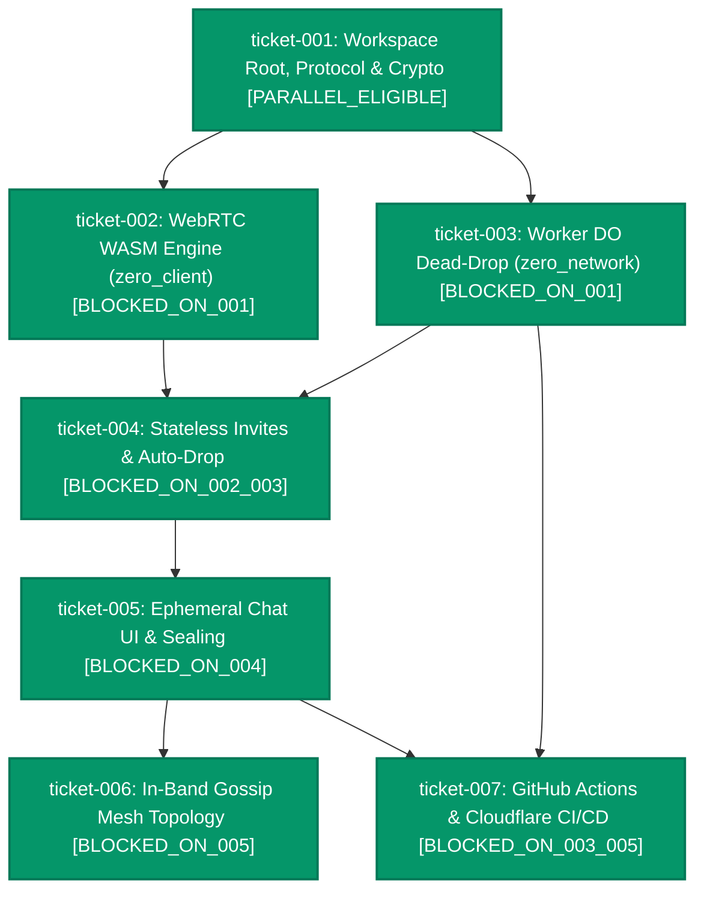

# Milestone Roadmap: Serverless P2P Ephemeral Communication Tool (Weekend MVP)

## 1. Milestone Objective & Scope

Build an entirely serverless, zero-footprint, real-time peer-to-peer (P2P) communication tool operating entirely inside modern web browsers using pure Rust compiled to WebAssembly (`wasm32-unknown-unknown`), coupled with a stateless Cloudflare Worker / Durable Object signaling bootstrap utilizing WebSocket Hibernation, with automated CI/CD via GitHub Actions and Cloudflare.

### Core Invariants & Architectural Boundaries
- **Zero Forensic Footprint**: No account registrations, no cookies, no local storage or IndexedDB persistence. Closing the browser tab destroys all ephemeral keys, sessions, and message logs.
- **Stateless HMAC-Sealed Handshake (Pattern B)**: Signaling dead-drop HTTP `POST` requests and hibernating WebSockets ($0 idle duration billing). Offline invites are sealed with `HMAC_SHA256(host_secret, Invite_UUID)` embedded in URL `#fragment`s, which never hit any cloud edge.
- **Pure Rust Cryptographic Engine**: Synchronous, memory-safe cryptographic primitives (`x25519-dalek`, `chacha20poly1305`, `hmac-sha256` with `getrandom/js`) shared between WASM and Cloudflare Worker, bypassing asynchronous JS WebCrypto bridging overhead.
- **Direct P2P DataChannels**: Once the initial WebRTC SDP offer/answer exchange completes, the cloud edge drops out permanently. All communication flows directly over browser-to-browser UDP DataChannels.
- **In-Band Gossip Mesh**: Multi-peer scaling without edge requests. The room host bridges encrypted signaling messages between existing WebRTC DataChannels so joining peers snap direct connections (`Channel_BC`) with zero edge hits.
- **Continuous Integration & Delivery**: Automated dual-target test validation, clippy auditing, and automated Cloudflare Worker + Cloudflare Pages deployment via GitHub Actions.

---

## 2. Ticket Dependency Matrix

| Ticket ID | Title | Thinking Level | Depends On | Concurrency Track | State |
| :--- | :--- | :---: | :--- | :--- | :--- |
| `ticket-001` | Workspace Architecture, Protocol Envelope & Crypto Primitives | `LOW` | `[]` | `PARALLEL_ELIGIBLE` | `COMPLETED` |
| `ticket-002` | WebRTC PeerConnection & DataChannel WASM Engine | `HIGH` | `["ticket-001"]` | `PARALLEL_ELIGIBLE` | `COMPLETED` |
| `ticket-003` | Cloudflare Worker Hibernating Durable Object Dead-Drop | `HIGH` | `["ticket-001"]` | `PARALLEL_ELIGIBLE` | `COMPLETED` |
| `ticket-004` | Stateless HMAC Invite Generator & URL Fragment Auto-Drop Joiner | `MEDIUM` | `["ticket-002", "ticket-003"]` | `PARALLEL_ELIGIBLE` | `COMPLETED` |
| `ticket-005` | Ephemeral Chat UI, Cryptographic Payload Sealing & E2E Validation | `MEDIUM` | `["ticket-004"]` | `PARALLEL_ELIGIBLE` | `COMPLETED` |
| `ticket-006` | In-Band Gossip Signaling Relay & Multi-Peer Mesh Topology | `HIGH` | `["ticket-005"]` | `PARALLEL_ELIGIBLE` | `COMPLETED` |
| `ticket-007` | CI/CD Automation: GitHub Actions & Cloudflare Deployment Pipeline | `LOW` | `["ticket-003", "ticket-005"]` | `PARALLEL_ELIGIBLE` | `COMPLETED` |

---

## 3. Blast Radius & Scope Collision Matrix

| Ticket ID | Declared File Scope | Overlap Detection & Blast Radius Rationale |
| :--- | :--- | :--- |
| `ticket-001` | `Cargo.toml`, `crates/zero_protocol/*`, `.gitignore`, `factory.yaml` | Establishes top-level cargo workspace and shared message schemas (`zero_protocol`). Clean foundational contracts; zero file overlap with downstream tasks. |
| `ticket-002` | `zero_client/Cargo.toml`, `zero_client/src/webrtc.rs`, `zero_client/src/lib.rs`, `zero_client/test_harness.html` | Pure client-side WebRTC WASM lifecycle and manual SDP exchange verification harness. Fully isolated within `zero_client/`; disjoint from `ticket-003`. Can execute concurrently with `ticket-003`. |
| `ticket-003` | `zero_network/Cargo.toml`, `zero_network/wrangler.toml`, `zero_network/src/*` | Cloudflare Worker & Durable Object dead-drop implementation. Fully isolated within `zero_network/`; zero overlap with `zero_client/`. Parallel execution safe alongside `ticket-002`. |
| `ticket-004` | `zero_client/src/invite.rs`, `zero_client/src/bootstrap.rs`, `zero_client/src/lib.rs` | Wires client URL `#fragment` parsing and automated HTTP `POST /drop/{DO_ID}/{UUID}` dispatch. Integrates the contracts established in `ticket-002` and `ticket-003`. |
| `ticket-005` | `zero_client/src/ui.rs`, `zero_client/src/crypto.rs`, `zero_client/index.html`, `zero_client/style.css`, `tests/e2e_handshake.rs` | Ephemeral chat UI, end-to-end symmetric payload sealing (`chacha20poly1305`), and automated integration test harness. Serialized after `ticket-004`. |
| `ticket-006` | `zero_client/src/mesh.rs`, `zero_client/src/webrtc.rs`, `zero_client/src/protocol.rs` | Multi-peer mesh relay over established DataChannels. Extends the 1:1 transport to an arbitrary N-peer fully connected mesh. Serialized after `ticket-005`. |
| `ticket-007` | `.github/workflows/*`, `docs/deployment.md`, `scripts/deploy_dry_run.sh` | Continuous integration and deployment configuration. Disjoint from application source code; can execute in parallel with `ticket-006` once `ticket-003` and `ticket-005` are completed. |

---

## 4. Execution DAG Diagram

> **Concurrency Highlights**:
> 1. Once `ticket-001` is completed, **`ticket-002`** (`zero_client`) and **`ticket-003`** (`zero_network`) execute in **parallel**.
> 2. Once `ticket-005` is completed, **`ticket-006`** (mesh topology) and **`ticket-007`** (CI/CD pipeline) execute in **parallel** without any file overlap.

---

## 5. Progress & Milestone Completion Criteria
- [x] Ticket-001 completed and merged to `main`.
- [x] Ticket-002 completed and merged to `main`.
- [x] Ticket-003 completed and merged to `main`.
- [x] Ticket-004 completed and merged to `main`.
- [x] Ticket-005 completed and merged to `main`.
- [x] Ticket-006 completed and merged to `main`.
- [x] Ticket-007 completed and merged to `main`.
- [x] End-to-end integration tests pass across combined deliverables (`cargo test --workspace`).
- [x] Zero persistent storage verified (no IndexedDB, localStorage, or cookies created).
- [x] Tab closure forensic cleanliness verified.
- [x] Automated GitHub Actions CI workflow passes on all branches.
- [x] Cloudflare deployment pipeline successfully deploys Worker and Pages bundle.
- [ ] Canonical specifications reconciled in `openspec/specs/overview.md`.
- [ ] Change proposals archived to `openspec/changes/archive/`.
